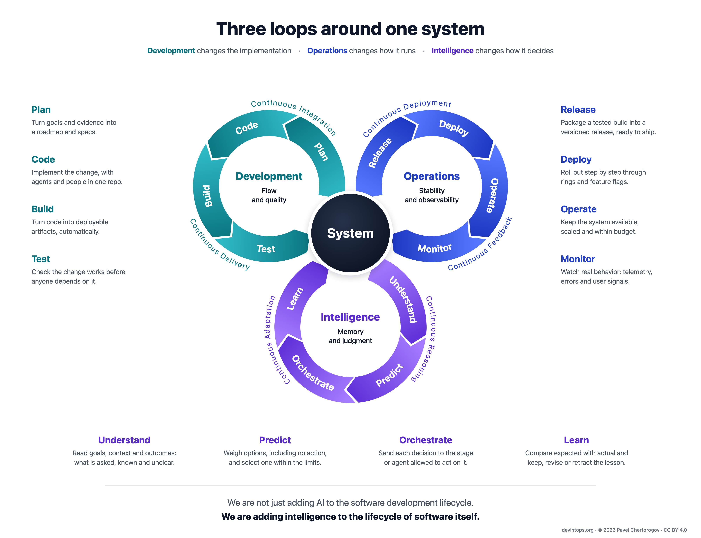

# DevIntOps

Source of [devintops.org](https://devintops.org): the paper *From Monovalent Dev to Bivalent DevOps to Trivalent DevIntOps: Intelligence as the Third Continuous Loop in Software Engineering*, currently a draft.

Development changes the implementation. Operations changes how it runs. Intelligence changes how it decides.



## What's here

| Path | What |
|---|---|
| `site/` | The published site. Plain HTML and CSS plus a few small vanilla scripts; no build step, no webfonts. Every page reads in full without JavaScript. |
| `site/v1/` | The paper, currently a draft. Once it is version 1.0 it is frozen; later versions get new URLs. |
| `site/v1/devintops-v1-draft.pdf` | PDF of the draft. At version 1.0 it becomes `devintops-v1.0.pdf`, for archives such as Zenodo. |
| `site/assets/diagrams/` | Diagrams as SVG (used on the pages and in the PDF) and as 2x PNG (download links and the README). |
| `site/assets/model/three-loops.svg` | The three-loops diagram with every stage, process, loop and the hub addressable, for the model explorer. Generated. |
| `site/assets/model-data.js` | What every word on the diagram means, the three walkthroughs and the valence notes. Edit explanations here. |
| `site/assets/explorer.js`, `selfcheck.js`, `discuss.js`, `site.js` | The model explorer, the interactive self-check, the GitHub Discussions comments, and small page behaviors such as opening folded sections for deep links. |
| `tools/` | `build_diagrams.py` (diagrams and social card), `render.sh` (PNGs and the PDF), `pdf_meta.py` (PDF metadata) and `giscus.py` (the comment widget's GitHub ids). |
| `CITATION.cff`, `.zenodo.json` | Citation metadata for GitHub's "Cite this repository" and for Zenodo. |
| `.github/workflows/pages.yml` | Deploys `site/` to GitHub Pages on every push to `main`. |

## Preview locally

```sh
python3 -m http.server --directory site 8000
# open http://localhost:8000
```

## Regenerate diagrams, social card and PDF

```sh
./tools/render.sh
```

It needs Python 3 and Google Chrome (set `CHROME=/path/to/chrome` elsewhere). The script rebuilds the SVGs (including the explorer's `site/assets/model/three-loops.svg`), renders them to PNG, renders the 1200×630 social card and prints `site/v1/index.html` to the PDF.

## Hosting

- GitHub Pages deploys `site/` with `.github/workflows/pages.yml` on every push to `main`. The custom domain is `devintops.org`, with HTTPS enforced; `www` redirects to it.
- DNS is on Cloudflare. The `A` and `AAAA` records for `devintops.org` point to GitHub Pages (`185.199.108.153` to `185.199.111.153`, and `2606:50c0:8000::153` to `2606:50c0:8003::153`) and `www` is a `CNAME` to `nodkz.github.io`. Keep every one of them **DNS only** (grey cloud): through the Cloudflare proxy, GitHub can't renew its certificate and browsers cache old files for hours.
- After a deploy, GitHub's cache serves the new files within about 10 minutes.
- Still to do: verify `devintops.org` for the `nodkz` account (GitHub Settings → Pages → Add a verified domain, then the TXT record it shows, in Cloudflare), so no other account can claim the domain for its Pages site.

## Comments

The paper and the home page show one shared thread through [giscus](https://giscus.app): discussion [#1, "DevIntOps"](https://github.com/nodkz/dev-int-ops/discussions/1), in the `Comments` category. That category uses the Announcements format, so only maintainers and giscus can open threads.

- giscus finds the thread by a hidden `sha1` marker in its body (strict mapping). Comment on the site or reply in #1. A discussion opened by hand won't show on the site.
- `tools/giscus.py` writes the repository and category ids into `site/assets/discuss.js`. Run it again only if the repository or the category changes.

## Releasing version 1.0

1. Replace the DRAFT labels: paper byline, nav, version note, version history, home page ledger, page titles, JSON-LD, `CITATION.cff`, `.zenodo.json`, `tools/pdf_meta.py` and the social card in `tools/build_diagrams.py`. Point `tools/render.sh` and the links at `devintops-v1.0.pdf`, set the release date wherever it appears (the pages, `CITATION.cff`, `.zenodo.json`, `sitemap.xml`), and rerun `tools/render.sh`.
2. Tag the release, for example `v1.0.0`. With the Zenodo GitHub integration switched on, Zenodo archives it and mints a DOI from `.zenodo.json`.
3. Put the DOI in the citation meta tags of `site/v1/index.html` and in `CITATION.cff`, and add a DOI column to the version table on the home page.
4. Save `https://devintops.org/v1/` and the PDF in the Wayback Machine: <https://web.archive.org/save>.
5. When you share it elsewhere, link `https://devintops.org/v1/`, and set that as the canonical link on any republished copy, such as Medium.

## Versioning

- `/v1/` holds the draft until version 1.0. From then on it stays as published: typos can be fixed; the meaning doesn't change.
- A substantive revision becomes `/v1.1/` or `/v2/`, with an entry in the version history and a new Zenodo version.
- The home page always points to the latest version.

## License

Text and diagrams © 2026 Pavel Chertorogov, licensed under [CC BY 4.0](https://creativecommons.org/licenses/by/4.0/). Scripts in `tools/` are MIT. See [LICENSE](LICENSE).
